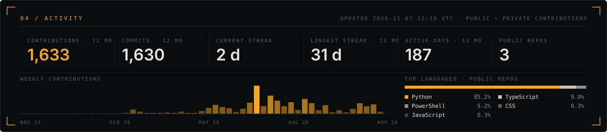
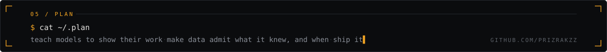

<div align="center">
  
</div>

<p align="center">
  <a href="https://www.linkedin.com/in/shahem-hiasat-70a75a213/"></a>
  <a href="mailto:shahemalhiasat@gmail.com"></a>
  
  
</p>


## `$ whoami`

```yaml
name:         Shahem Hiasat
role:         Machine Learning Engineer
based:        Amman, Jordan (UTC+3)
works_on:     [enterprise LLM systems, predictive modeling, data platforms, MLOps]
clouds:       [AWS, Azure]
day_job:      AI & Information Management Officer, Tekiyet Um Ali (200+ staff NGO)
before_that:  AI & Advanced Data Analytics, Arab Bank
after_hours:  Leviathan Research, an AI research terminal for agricultural commodities (solo, AWS)
degree:       B.Sc. Data Science & Artificial Intelligence, PSUT, 2025
certified:    AWS Certified Machine Learning Associate, 2026
speaks:       [English, Arabic]
```


## How I work

- **Forward-deployed.** I build next to the people who will use the system, from scoping with department heads through rollout and handover.
- **Quantitative first.** Statistics, time series and neural networks are the foundation; the framework is chosen after the question is framed. Gradient boosting with SHAP, PyTorch, TensorFlow, embeddings and NLP.
- **Production LLM systems.** RAG, agents and guardrails designed to pass compliance review: hybrid retrieval, cited answers, audit trails, PII masking, data residency. Azure OpenAI, Azure AI Search, LangGraph, Claude API and Bedrock.
- **Data engineering and analytics, one discipline.** Lakehouse design, point-in-time modeling, pipeline orchestration on AWS and Azure, Snowflake and Redshift warehousing, and the executive dashboards on top.
- **End-to-end ownership.** Requirements, architecture, Terraform, CI/CD, security review, rollout. Measured in staff-hours returned and compute spend avoided.
- **After hours.** Leviathan Research, a point-in-time research terminal for agricultural commodities: causal knowledge graph, claim-verified Claude agents, 20-source lakehouse, built solo on AWS.


## Stack

<table align="center">
  <tr>
    <td align="right"><code>ML / AI</code></td>
    <td>
      
      
      
      
      
      
      
      
      
    </td>
  </tr>
  <tr>
    <td align="right"><code>LLM / AGENTS</code></td>
    <td>
      
      
      
      
      
      
      
      
    </td>
  </tr>
  <tr>
    <td align="right"><code>AWS</code></td>
    <td>
      
      
      
      
      
      
      
      
      
      
      
      
      
    </td>
  </tr>
  <tr>
    <td align="right"><code>AZURE</code></td>
    <td>
      
      
      
      
      
      
    </td>
  </tr>
  <tr>
    <td align="right"><code>DATA</code></td>
    <td>
      
      
      
      
      
      
      
      
      
    </td>
  </tr>
  <tr>
    <td align="right"><code>CODE</code></td>
    <td>
      
      
      
      
      
      
      
    </td>
  </tr>
  <tr>
    <td align="right"><code>INFRA</code></td>
    <td>
      
      
      
      
      
    </td>
  </tr>
</table>


## Activity

<div align="center">
  
</div>

<div align="center">
  <picture>
    <source media="(prefers-color-scheme: dark)" srcset="https://raw.githubusercontent.com/Prizrakzz/Prizrakzz/output/github-snake-dark.svg">
    
  </picture>
</div>


